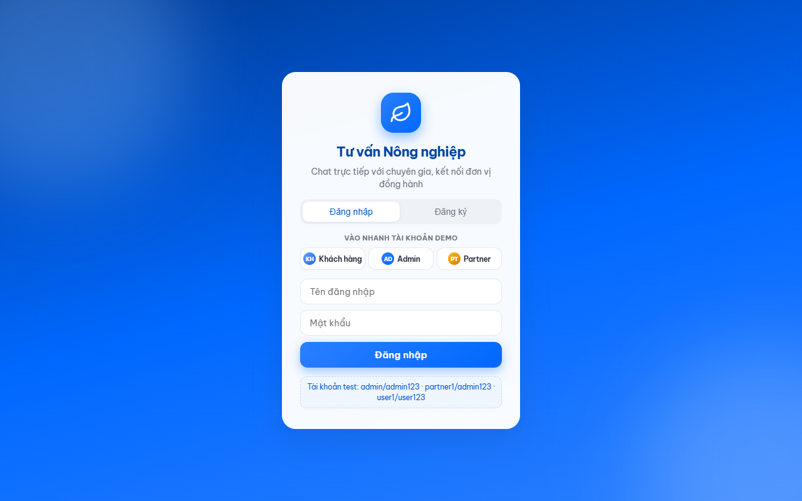
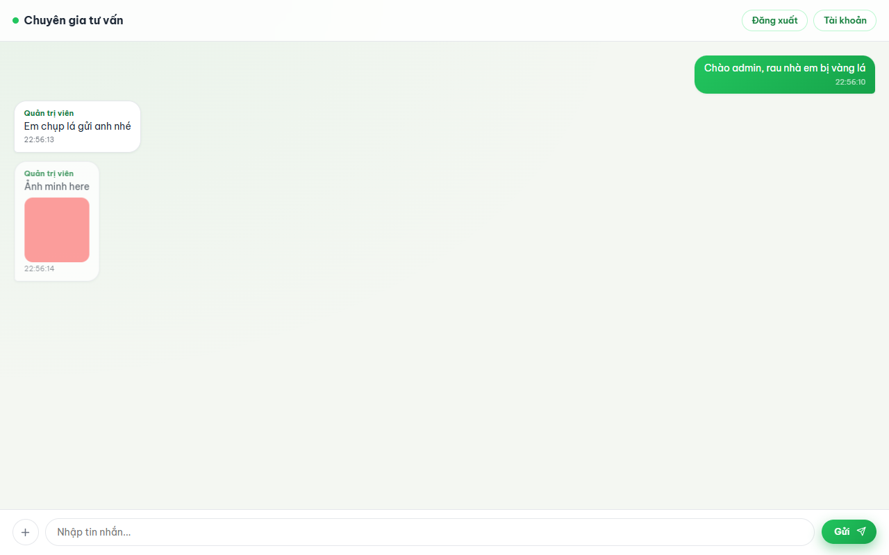
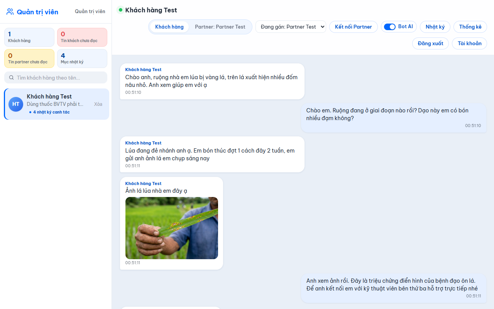
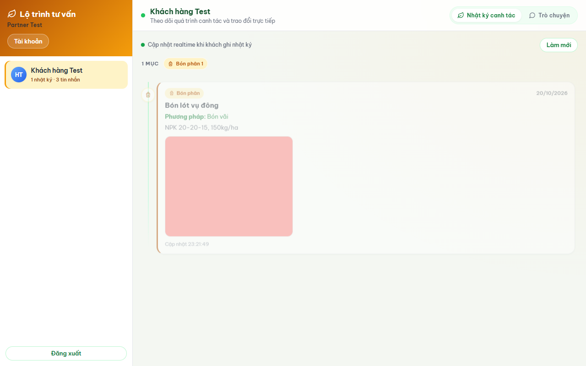
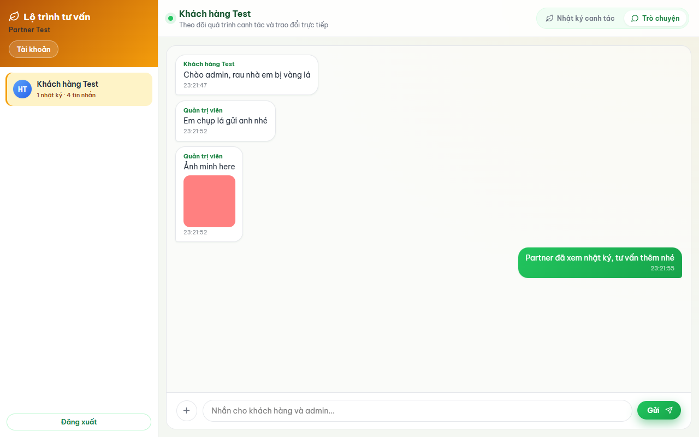

# Tư vấn Nông nghiệp — Realtime Chat (User · Admin · Partner · Bot AI)

Hệ thống web tư vấn trực tuyến cho lĩnh vực nông nghiệp, mô phỏng trải nghiệm chat kiểu Zalo:
khách hàng tự ghi **nhật ký canh tác** (mùa vụ, phương pháp, ảnh), trò chuyện realtime với admin;
admin gán chuyên gia/bên thứ ba (partner) đồng hành — mỗi cặp trò chuyện là một luồng **riêng tư**:
admin↔khách, partner↔khách và partner↔admin không nhìn thấy tin của nhau.
Bot AI "Trợ lý AI" tự động trả lời khách hàng trong luồng admin↔khách (admin bật/tắt cho từng khách);
giao diện phong cách Zalo (xanh dương #0068FF).



| User — chat + nhật ký canh tác | Admin — sidebar + gán Partner |
|---|---|
|  |  |

| Partner — nhật ký của khách | Partner — chat riêng |
|---|---|
|  |  |

## Tính năng

**Khách hàng (User)**
- Tự đăng ký / đăng nhập, đổi mật khẩu, tự xóa tài khoản (cascade lịch sử chat).
- Chat realtime với admin và **chat riêng** với partner: tab chuyển luồng, gửi ảnh/tài liệu/tin nhắn thoại (tối đa 5MB), typing indicator, trạng thái bubble "đang gửi", nhãn "Đã xem".
- **Tìm kiếm trong lịch sử chat** (nút kính lúp trên header): gõ từ khóa → danh sách tin khớp, bấm một kết quả để nhảy tới đúng tin và highlight.
- **Bot AI** trả lời tức thì các câu hỏi nông nghiệp phổ biến (sâu bệnh, phân bón, nước tưới...) ngay trong luồng chat với admin — hiển thị dạng stream có con trỏ nhấp nháy; ngoài giờ làm việc bot trả lời thông điệp hẹn phản hồi.
- **Nhật ký canh tác**: ghi hoạt động (gieo hạt, bón phân, tưới nước, phun thuốc, tỉa cành, thu hoạch, khác), ngày thực hiện, phương pháp, chi tiết và **tối đa 5 ảnh/tệp mỗi mục**; xem timeline có thống kê, lọc theo hoạt động/khoảng ngày/**mùa vụ**, xuất CSV, tự xóa mục của mình.
- Lỗi mạng / bị rate-limit: tin chưa gửi được tự trả lại ô nhập, không mất nội dung.
- Tab "Partner: <tên>" xuất hiện khi admin gán partner; chấm đỏ báo tin mới ở luồng còn lại.

**Admin**
- Sidebar danh sách khách hàng: 4 thẻ tổng quan (khách hàng, tin khách chưa đọc, tin partner chưa đọc, mục nhật ký), ô tìm kiếm theo tên/tên đăng nhập, preview tin cuối, badge đỏ, badge vàng, số mục nhật ký, xóa khách. Số liệu badge/tổng quan cập nhật realtime.
- Chat realtime nhiều cuộc hội thoại; mỗi khách có 2 tab riêng: "Khách hàng" và "Partner: <tên>"; gán partner bằng dropdown, **hủy liên kết** partner qua **popup xác nhận** (không dùng hộp thoại mặc định của trình duyệt), đổi mật khẩu. Tìm kiếm trong lịch sử từng luồng chat.
- Xem nhật ký canh tác của từng khách trong drawer; lọc theo hoạt động/khoảng ngày/mùa vụ, xuất CSV, cập nhật mới hiện realtime.
- Badge đỏ chỉ đếm tin khách trong luồng admin↔khách; badge vàng chỉ đếm tin partner trong luồng partner↔admin (watermark id tin, không đếm tin mình gửi).
- **Dashboard Thống kê** (nút "Thống kê"): chọn khoảng **7 / 30 / 90 ngày**; KPI (khách hàng, tin nhắn, mục nhật ký, partner), biểu đồ cột tin nhắn theo ngày, biểu đồ tròn hoạt động nhật ký theo màu, top 5 khách nhắn nhiều nhất trong khoảng đã chọn.
- **Bot AI**: toggle bật/tắt trợ lý AI cho từng khách ngay trên header chat; khi bot không chắc câu hỏi, admin nhận toast + ping để vào trả lời.

**Partner (bên thứ ba)**
- Chỉ thấy khách được admin gán; mở sẵn khách đầu tiên, theo dõi **nhật ký canh tác**.
- Ba tab: "Nhật ký canh tác" (timeline + ảnh), "Nhắn khách hàng" và "Nhắn admin" — hai luồng chat riêng biệt, không nhìn thấy chat admin↔khách; tìm kiếm trong lịch sử từng luồng.
- Nút **Tài khoản** (đổi mật khẩu) nằm trên taskbar đầu trang, cạnh nút tìm kiếm; panel xổ xuống thẳng hàng.
- Không tạo/xóa được nhật ký; server chặn thao tác ghi nhật ký ở REST. Quyền chat bị thu hồi ngay khi khách được gán partner khác hoặc admin hủy liên kết.

**Chung**
- Nhật ký realtime: khách thêm/xóa mục → admin và partner đang được gán thấy cập nhật (socket `process-updated`).
- Ghi âm tin nhắn thoại trực tiếp (MediaRecorder, tối đa 60 giây) ở cả 3 giao diện: bấm micro để ghi, dừng là tự tải lên và gửi; bubble có audio player phát lại.
- Lịch sử chat phân trang (50 tin/trang, nút "Tải tin cũ hơn" giữ nguyên vị trí đọc).
- Trang đăng nhập có 3 nút "Vào nhanh" cho tài khoản demo (Khách hàng / Admin / Partner): bấm là vào thẳng trang của role, không cần gõ mật khẩu.
- Hiệu ứng nền ambient, empty state động, toast thông báo, avatar chữ cái theo role, đèn trạng thái kết nối, responsive + `prefers-reduced-motion`.
- Giao diện phong cách **Zalo**: xanh dương #0068FF, bubble tin của mình xanh nhạt chữ tối, bubble đối phương trắng, ô nhập pill + nút gửi tròn, nền chat xám nhạt.
- **Lightbox** xem ảnh to: bấm ảnh trong chat hoặc nhật ký để phóng to, đóng bằng × / bấm nền / Esc.
- **Thông báo**: âm "ping" (Web Audio, không cần file) + số tin chưa đọc trên title tab `(n)` ở cả 3 role khi có tin mới ở luồng đang không mở.
- Session sống sót qua restart server (SQLite store), tự cấp session id mới khi đăng nhập.
- Bot AI: trả lời theo knowledge base tiếng Việt 12 chủ đề (offline, không cần API key); khi set `LLM_API_KEY` (Gemini/OpenAI-compatible) bot trả lời bằng LLM với stream realtime. Thứ tự: **LLM chính → LLM fallback (`LLM_FALLBACK_*`) → LLM fallback 2 (`LLM_FALLBACK2_*`) → rule-based**; câu trả lời LLM được cache theo câu hỏi để tiết kiệm token.

## Kiến trúc

```
Browser (Vanilla JS, không bundler)
  │  REST /api/*            WebSocket /ws (Socket.io)
  ▼                              ▼
Express + express-session   Socket.io server
  │  requireAuth/requireRole     │  handshake ?sessionId= → tra session store
  │                              │  room conv_<id> (mỗi thread), room admins
  ▼                              ▼
SQLite (better-sqlite3, WAL) — users · conversations · messages · process_entries · sessions
  ▲
  └── multer → public/uploads/ (whitelist đuôi + kiểm tra magic bytes)
```

- **Backend**: Node.js + Express 4 + Socket.io 4. Bot engine (`bot.js` + `knowledge-base.js` + `reply-cache.js`): matching keyword tiếng Việt (không dấu, whole-word) + LLM streaming (Gemini/OpenAI-compatible qua env `LLM_*`) với 3 tầng API: chính → fallback → fallback 2 → rule-based; cache câu trả lời LLM (LRU 200, TTL 24h); ngoài giờ làm việc trả thông điệp cố định.
- **Database**: SQLite (better-sqlite3), WAL + `busy_timeout`, index `messages(conversation_id, id)` và `process_entries(user_id, performed_at DESC, id DESC)`.
- **Auth**: express-session + SQLite session store tự viết; bcryptjs; socket xác thực bằng `sessionId`.
- **Upload**: multer, giới hạn 5MB, kiểm tra chữ ký file (magic bytes) khớp phần mở rộng — ảnh, tài liệu và âm thanh (webm/ogg/mp3/wav/m4a).
- **Frontend**: HTML5 + CSS3 + Vanilla JavaScript (không build tool).

## Chạy nhanh

Yêu cầu: Node.js 20+.

```bash
npm ci            # hoặc npm install
cp .env.example .env   # tùy chọn: chỉnh PORT / SESSION_SECRET
npm start         # http://localhost:3000
```

Tài khoản seed (tự tạo khi DB rỗng):

| Role    | Username | Password |
|---------|----------|----------|
| Admin   | admin    | admin123 |
| Partner | partner1 | admin123 |
| User    | user1    | user123  |

> `partner1` dùng chung mật khẩu `admin123` để tiện test.

### Biến môi trường

| Biến | Mặc định | Ghi chú |
|---|---|---|
| `PORT` | `3000` | Cổng HTTP |
| `SESSION_SECRET` | chuỗi dev | **Phải đổi khi deploy thật** |
| `DB_PATH` | `./data/app.db` | File SQLite |
| `NODE_ENV` | — | `production` / `development` |
| `DB_DEBUG` | — | `1` để log SQL |
| `LLM_PROVIDER` | `off` | `off` / `gemini` / `openai` — bật LLM cho Bot AI |
| `LLM_API_KEY` | — | Key LLM; bỏ trống → bot chạy rule-based offline |
| `LLM_MODEL` | `gemini-3.1-flash-lite` | Model LLM (deepseek-chat, gpt-4o-mini...) |
| `LLM_BASE_URL` | — | Base URL OpenAI-compatible (DeepSeek, Ollama...) |
| `LLM_FALLBACK_PROVIDER` | `off` | `off` / `gemini` / `openai` — API dự phòng khi LLM chính lỗi/quá tải/timeout |
| `LLM_FALLBACK_API_KEY` | — | Key của API dự phòng (ví dụ Groq: https://console.groq.com/keys) |
| `LLM_FALLBACK_MODEL` | theo provider | Model fallback (ví dụ `openai/gpt-oss-120b` của Groq) |
| `LLM_FALLBACK_BASE_URL` | — | Base URL fallback (ví dụ `https://api.groq.com/openai/v1`) |
| `LLM_FALLBACK2_PROVIDER` | `off` | Bậc dự phòng thứ 2 (cùng định dạng với bậc 1) |
| `LLM_FALLBACK2_API_KEY` | — | Key của bậc 2 |
| `LLM_FALLBACK2_MODEL` | theo provider | Model bậc 2 (mặc định `openai/gpt-oss-120b` cho Groq) |
| `LLM_FALLBACK2_BASE_URL` | `https://api.groq.com/openai/v1` | Base URL bậc 2 |
| `OFFICE_HOURS` | `8-17` | Giờ làm việc của bot, dạng `batdau-ketthuc` (end-exclusive). Ngoài giờ bot trả thông điệp hẹn phản hồi. `0-24` = luôn trong giờ (test) |
| `UPLOAD_CLEANUP_INTERVAL_HOURS` | `24` | Chu kỳ job dọn file rác trong `public/uploads/` (0 = tắt) |
| `UPLOAD_CLEANUP_MIN_AGE_HOURS` | `24` | Chỉ xóa file không còn được tham chiếu và cũ hơn mốc này |

Dự án đọc `.env` bằng `dotenv`; biến môi trường trong shell vẫn được ưu tiên hơn file.

## Hướng dẫn sử dụng

### Khách hàng (User)

1. Mở `http://localhost:3000`, đăng nhập `user1/user123` (hoặc bấm nút **Khách hàng** ở mục "Vào nhanh"); tab **Đăng ký** để tạo tài khoản mới.
2. Chat với admin ở tab **Chuyên gia**, chat riêng với partner ở tab **Partner: <tên>** (xuất hiện sau khi admin gán).
3. Gõ tin + Enter để gửi; nút ghim đính kèm ảnh/tài liệu (≤5MB); nút micro ghi tin nhắn thoại (≤60 giây, dừng là tự gửi).
4. Bot AI tự trả lời câu hỏi nông nghiệp trong tab Chuyên gia khi admin bật; ngoài giờ làm việc bot hẹn phản hồi.
5. Nút kính lúp trên header → tìm trong lịch sử luồng đang mở; bấm kết quả để nhảy tới tin đó (highlight xanh).
6. Nút **Nhật ký** → **Thêm mục**: chọn hoạt động, ngày thực hiện, phương pháp, chi tiết, đính kèm tối đa 5 ảnh/tệp. Lọc theo hoạt động/khoảng ngày/mùa vụ, xuất CSV, xóa mục của mình.
7. Panel **Tài khoản** (góc phải): đổi mật khẩu, tự xóa tài khoản.
8. Nút "Tải tin cũ hơn" xem lịch sử; tin của mình hiện **Đã xem** khi đối phương đọc.

### Admin

1. Đăng nhập `admin/admin123` → tự vào `/admin`.
2. Sidebar: tìm khách theo tên/username, theo dõi badge đỏ (tin khách chưa đọc), badge vàng (tin partner chưa đọc), số mục nhật ký, preview tin cuối; bấm khách để mở hội thoại.
3. Tab **Khách hàng** (luồng admin↔khách) và **Partner: <tên>** (luồng partner↔admin) — hoàn toàn riêng tư, admin không thấy chat partner↔khách.
4. Header chat: chọn partner trong dropdown + **Kết nối Partner** để gán; khi đã gán hiện chip "Đã kết nối" + nút **Hủy liên kết** (xác nhận trước khi hủy; lịch sử được giữ, gán lại tái sử dụng thread cũ).
5. Toggle **Bot AI** bật/tắt trợ lý cho khách đang mở; khi bot không chắc câu hỏi, admin nhận toast + ping để vào trả lời.
6. Nút **Nhật ký** xem/lọc/xuất CSV nhật ký của khách; nút **Thống kê** xem KPI + biểu đồ theo **7 / 30 / 90 ngày**.
7. Kính lúp tìm trong lịch sử luồng đang mở; nút xóa khách trong sidebar (xóa cascade dữ liệu liên quan).
8. Panel **Tài khoản**: đổi mật khẩu.

### Partner (bên thứ ba)

1. Đăng nhập `partner1/admin123` → tự vào `/partner`.
2. Sidebar danh sách khách được admin gán; hệ thống mở sẵn khách đầu tiên.
3. Ba tab: **Nhật ký canh tác** (timeline + ảnh, lọc/xuất CSV), **Nhắn khách hàng**, **Nhắn admin** — hai luồng chat tách biệt, không thấy chat admin↔khách.
4. Kính lúp tìm trong lịch sử luồng đang mở; partner không tạo/xóa được nhật ký; quyền bị thu hồi ngay khi admin hủy liên kết hoặc gán khách cho partner khác.

### Cấu hình Bot AI (tùy chọn)

- Chạy offline rule-based: để trống `LLM_API_KEY` (12 chủ đề tiếng Việt).
- Bật LLM: `LLM_PROVIDER=gemini` (hoặc `openai` + `LLM_BASE_URL`) + `LLM_API_KEY` + `LLM_MODEL`.
- Dự phòng khi LLM chính lỗi/quá tải: `LLM_FALLBACK_*` (bậc 1) rồi `LLM_FALLBACK2_*` (bậc 2, mặc định Groq `openai/gpt-oss-120b`); hết fallback mới về rule-based.
- `OFFICE_HOURS=8-17` giới hạn giờ bot tư vấn (end-exclusive); ngoài giờ bot trả thông điệp hẹn. `0-24` = luôn trong giờ.

## Kiểm thử

```bash
npm run e2e        # 182 test: REST + socket + upload + nhật ký (nhiều ảnh) + 3 luồng chat + phân trang/tìm kiếm/around + rate-limit + session persist + CSRF + security + stats 7/30/90 ngày + Bot AI (toggle, off-hours, bot-unsure, fallback 1/2 + cache)
npm run ui-check   # 116 check UI trên Edge/Chrome headless (tự spawn server + DB riêng; ghi âm dùng micro giả; dashboard 7/30 ngày, tìm kiếm chat, lightbox, title unread, Bot AI toggle, read receipt, popup hủy liên kết, taskbar partner 1 hàng cân với sidebar)
```

- `e2e` chạy server tạm ở port `3100`, DB `data/e2e.db` (luôn xóa trước khi chạy).
- `ui-check` tự spawn server + DB `data/ui-check.db`, chụp screenshot vào `.verify/`.
  - Máy khác không có Edge/Chrome mặc định: set `UI_BROWSER=/đường/dẫn/browser`.
  - Chạy trên server sẵn có (DB phải mới): `UI_BASE=http://localhost:3000 npm run ui-check`.
- CI (GitHub Actions): job `e2e` chạy trên Node 20 và 22; job `ui-check` chạy trên Node 22 (dùng Google Chrome có sẵn của runner).

## API chính

| Method | Endpoint | Quyền |
|---|---|---|
| POST | `/api/register` | Public (rate-limit 10/10 phút/IP) |
| POST | `/api/login` | Public (rate-limit 20/5 phút/IP) |
| POST | `/api/logout` | Đã đăng nhập |
| GET | `/api/csrf` | Đã đăng nhập — trả CSRF token của session |
| GET | `/api/me` | Đã đăng nhập (user: `conversation_id` + `partner` nếu đã gán) |
| POST | `/api/me/password` | Đã đăng nhập |
| DELETE | `/api/me` | User (tự xóa tài khoản) |
| GET | `/api/conversations/:id/messages?before=&around=&limit=` | Theo `canAccessConversation` (3 luồng riêng) |
| GET | `/api/conversations/:id/search?q=` | Theo `canAccessConversation` (tối đa 30 kết quả mới nhất, q 2–200 ký tự) |
| GET | `/api/admin/users` · `/api/admin/partners` · `/api/admin/stats?days=7\|30\|90` | Admin (`stats`: KPI + chuỗi ngày + phân bố hoạt động + top 5 khách trong khoảng) |
| POST | `/api/admin/conversations/:id/connect` | Admin |
| POST | `/api/admin/conversations/:convId/disconnect` | Admin (hủy liên kết partner, giữ lịch sử) |
| POST | `/api/admin/conversations/:convId/bot` | Admin (bật/tắt Bot AI cho khách, body `{ enabled: boolean }`) |
| DELETE | `/api/admin/users/:id` | Admin |
| GET | `/api/partner/conversations` | Partner (kèm `process_count`, `message_count`, 2 thread id) |
| GET | `/api/process?userId=` | Admin / owner / partner được gán |
| POST | `/api/process` | User (tạo mục nhật ký của chính mình, tối đa 5 tệp/mục) |
| DELETE | `/api/process/:id` | Owner hoặc admin |
| POST | `/api/upload` | Đã đăng nhập (rate-limit 30/10 phút/user) |

Mọi request đổi dữ liệu (POST/PUT/PATCH/DELETE) tới `/api` đều phải kèm header
`X-CSRF-Token` lấy từ `GET /api/csrf` (miễn `/api/login` và `/api/register`); thiếu/sai → `403`.

Phân trang: mặc định trả 50 tin **mới nhất** (sắp cũ → mới), tối đa 100; `has_more` báo còn tin cũ;
`before=<id tin>` lấy trang cũ hơn; `around=<id tin>` lấy trang quanh tin đó (dùng khi nhảy tới kết quả tìm kiếm).

Luồng chat: `conversations.kind` = `user_admin` (khách↔admin), `partner_user` (khách↔partner),
`partner_admin` (partner↔admin). `GET /api/admin/users` trả thêm `partner_id`, `partner_name`,
`partner_conversation_id`, `partner_unread`, `bot_enabled`; connect trả `partnerUserConversationId` + `partnerConversationId`.
`canAccessConversation`: admin không vào `partner_user`, user không vào `partner_admin`, partner chỉ vào 2 thread
của khách đang được gán (kiểm tra lại `user_admin.partner_id`).

### Socket events (`path: /ws`, handshake `?sessionId=`)

| Chiều | Event | Payload |
|---|---|---|
| Client → Server | `join` | `{ convId }` |
| Client → Server | `message` | `{ convId, content, attachment?, clientId? }` (rate-limit 8 tin/10s; qua `canAccessConversation`; content cắt 4000 ký tự; attachment phải là file thật trong `/uploads/`) |
| Client → Server | `read` | `{ convId }` (mọi role — đánh dấu đã đọc phía mình) |
| Client → Server | `typing` | `{ convId, isTyping }` (chỉ relay khi trạng thái đổi) |
| Server → Client | `joined`, `message` (kèm `senderRole`, echo `clientId`), `read-by`, `unread-badge`, `badge-cleared`, `partner-badge`, `partner-badge-cleared`, `typing`, `bot-stream`, `process-updated`, `error` | |
| Server → Client | `read-by` | `{ convId, userId, userSide, seenUpTo }` — bên kia đã đọc, hiện "Đã xem" cho tin của mình có id ≤ `seenUpTo` |
| Server → Admin room | `user-message` | Tin mới từ khách trong `user_admin` (kèm preview để refresh sidebar) |
| Server → Admin room | `partner-message` | Tin mới từ partner trong `partner_admin` (badge vàng) |
| Server → Admin room | `bot-unsure` | `{ convId, userId, userName, preview }` — bot không chắc câu trả lời, nhắc admin vào tư vấn |
| Server → room `conv_<id>` | `bot-stream` | `{ convId, delta, clientId }` — Bot AI trả lời từng cụm chữ; kết thúc bằng `message` senderRole=bot cùng `clientId`. LLM chính lỗi giữa chừng → server gửi `{ reset: true }` để client xóa stream dở trước khi API fallback gõ tiếp |

`process-updated` bắn tới room `admins`, room `user_admin` và room `partner_user` của partner đang gán khi khách thêm/xóa mục nhật ký:
`{ userId, userName, convId, action: 'created' | 'deleted', entryId }`.

Bot AI chỉ trả lời khi khách gửi tin trong `user_admin` và `bot_enabled=1`; tin bot không tạo badge unread, không bị rate-limit socket.

## Bảo mật đã áp dụng

- Mật khẩu hash bcrypt; session id mới khi login (chống session fixation), cookie `httpOnly`.
- Kiểm tra quyền ở cả REST và socket theo từng thread (`canAccessConversation`): admin không vào partner↔khách, user không vào partner↔admin, partner không vào admin↔khách; quyền partner gắn với phân công hiện tại.
- Upload: whitelist đuôi file (ảnh/tài liệu/âm thanh), giới hạn 5MB, magic bytes, tên file random (chặn path traversal).
- Tin nhắn: `attachment.url` do client gửi phải là file tồn tại trong `public/uploads/` (chặn tracking pixel ngoài domain + `..`); nội dung cắt 4000 ký tự.
- Security headers: `X-Content-Type-Options: nosniff`, `X-Frame-Options: SAMEORIGIN`, `Referrer-Policy: same-origin`.
- **CSRF token per session**: mọi POST/PUT/PATCH/DELETE tới `/api` (trừ login/register) phải gửi header `X-CSRF-Token` khớp token của session (lấy từ `GET /api/csrf`); thiếu/sai → 403. Client tự gắn token qua `api()`/`uploadFile()`.
- Rate-limit login/register/upload và chống spam socket message.
- Frontend render bằng `textContent`/DOM API (chống XSS), không dùng `innerHTML` với dữ liệu người dùng.
- Job dọn file rác uploads chạy nền định kỳ: chỉ xóa file không còn được message/nhật ký tham chiếu và cũ hơn 24 giờ.
- `.env` và `data/`, `public/uploads/` không commit.

## Cấu trúc thư mục

```
server.js            # Express + Socket.io + page guards
auth.js              # requireAuth / requireRole / login (regenerate session)
rate-limit.js        # Rate limiter cửa sổ trượt trong bộ nhớ
db.js                # Schema, migration, helpers (3 loại conversation, phân trang, 2 watermark unread, bot_enabled, user ảo ai-bot)
bot.js               # Bot AI: normalize/match tiếng Việt + LLM streaming (chính → fallback → fallback 2 → rule-based) + off-hours
knowledge-base.js    # Kiến thức 12 chủ đề nông nghiệp (keywords + câu trả lời)
reply-cache.js       # Cache câu trả lời LLM (LRU 200, TTL 24h)
uploads-cleanup.js   # Job dọn file rác trong public/uploads/
session-store.js     # express-session store trên SQLite
routes/              # auth (+/csrf), chat (messages/search/around), admin (+stats/disconnect/bot), partner, process, upload
public/              # index/chat/admin/partner.html, css/base.css, auth.css, chat.css, process.css, admin.css, partner.css, js/*.js, favicon.svg
public/js/process.js # timeline + drawer nhật ký dùng chung; lọc hoạt động/khoảng ngày/mùa vụ, nhiều ảnh + xuất CSV
scripts/e2e.js       # E2E tự spawn server + DB tạm
scripts/ui-check.js  # UI check headless (Playwright-core + Edge/Chrome)
docs/screenshots/    # Ảnh cho README
```

## Hạn chế & hướng phát triển

- Chưa rate-limit toàn bộ API; CSRF token chưa rotate định kỳ (chỉ cấp một lần/session).
- Tìm kiếm chat trả tối đa 30 kết quả mới nhất, chưa phân trang kết quả; chưa tìm xuyên nhiều luồng.
- Nhật ký giới hạn 200 mục gần nhất/khách, tối đa 5 tệp/mục; chưa xuất PDF/Excel.
- Lịch sử chat phân trang theo id; chưa virtualize DOM cho hội thoại rất dài.
- Rate limiter và cache câu trả lời LLM lưu trong bộ nhớ → mất khi restart, cần Redis nếu chạy nhiều instance.
- Bot AI: rule-based còn giới hạn 12 chủ đề; có thể mở rộng KB, học từ phản hồi thật, thống kê câu hỏi bot không trả lời được.
- Dashboard giới hạn 7/30/90 ngày; có thể bổ sung thống kê theo tháng/mùa vụ và xuất báo cáo.
- Có thể bổ sung thông báo push (Notification API + service worker).
